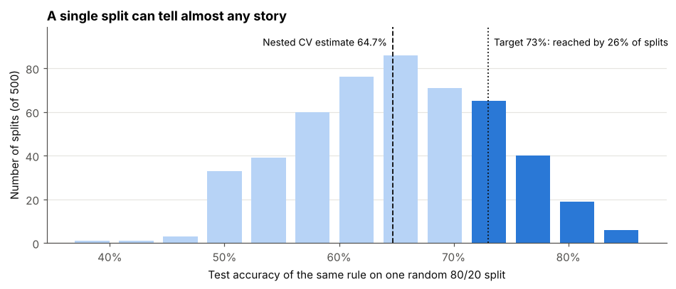
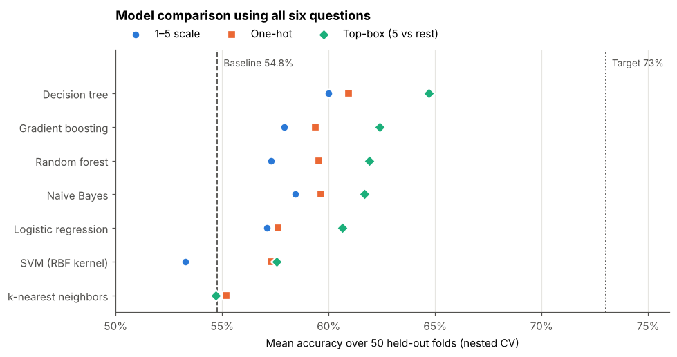
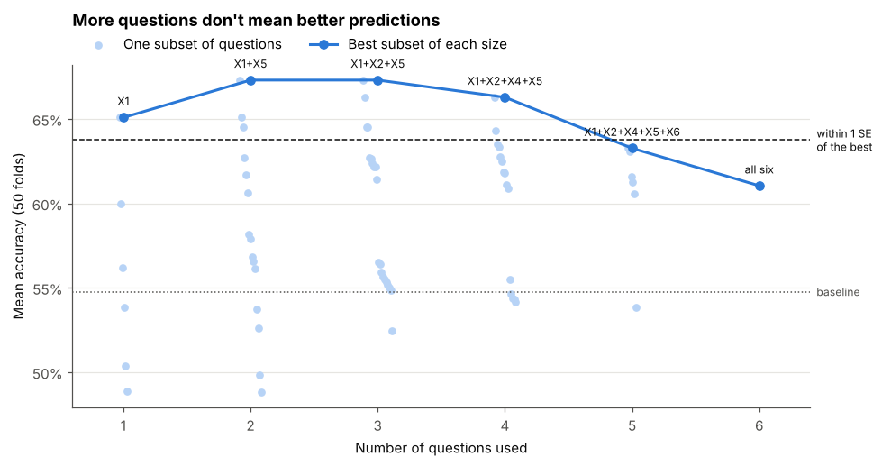
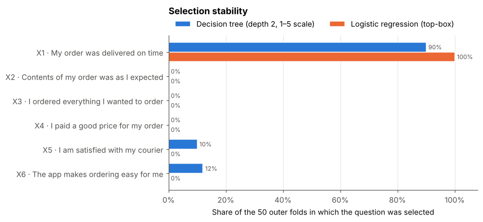

# Customer Happiness Prediction

[](https://github.com/layalsaad/8HX5I2cEoQZKSqlg/actions/workflows/ci.yml)

Predict whether a customer is happy (`Y = 1`) or unhappy (`Y = 0`) from their answers to a
six-question delivery survey, and identify which questions matter most.

| Column | Survey question (answers 1 = least, 5 = most) |
| ------ | --------------------------------------------- |
| `X1`   | My order was delivered on time                |
| `X2`   | Contents of my order was as I expected        |
| `X3`   | I ordered everything I wanted to order        |
| `X4`   | I paid a good price for my order              |
| `X5`   | I am satisfied with my courier                |
| `X6`   | The app makes ordering easy for me            |

**Goals**

- Predict happiness with at least 73% accuracy, or show why the solution is superior.
- Find the minimal set of questions that preserves predictive power, and whether any question
  can be removed from the next survey.

## Results at a glance

| Question                                    | Answer                                                                   |
| ------------------------------------------- | ------------------------------------------------------------------------ |
| Expected accuracy on new customers          | **≈ 65%** (nested cross-validation, 50 held-out folds) vs 54.8% baseline |
| Does it beat guessing?                      | Yes, significantly (corrected t-test, p = 0.017)                         |
| Best model                                  | A single rule: **happy if X1 = 5** (order delivered fully on time)       |
| Most important question                     | **X1**, by every method used                                             |
| Minimal set of questions                    | **X1** (optionally + X5)                                                 |
| Questions that can be removed               | **X2, X3, X4** (and X6 if the survey is only used for prediction)        |
| Can the 73% target be reached on this data? | Not under honest evaluation. See below for why 65% is the right number   |

## Why ≈65% and not 73%

With 126 customers, a typical 80/20 split tests on just 26 people, so each customer moves accuracy
by almost 4 points. Scoring the _same_ one-line rule on 500 random splits gives anywhere from
**38% to 85%**, and **26% of splits reach the 73% target purely by chance**. A solution that
reports one such split would "meet" the goal and then disappoint on the private test set.



This solution is built to give a number the business can rely on:

- **Nested cross-validation.** 5-fold CV is repeated 10 times, giving 50 held-out folds.
  Hyperparameters are tuned _inside_ each training fold, so the test folds never influence any
  choice.
- **Significance testing.** Model differences are checked with the corrected resampled t-test
  (Nadeau & Bengio), which accounts for overlapping CV training sets.
- **A noise ceiling in the data itself.** 17 customers gave exactly the same answers as someone
  with the opposite outcome. Happiness depends on things the survey doesn't ask, and no model can
  get those customers right.
- **An explainable result.** The final model is a rule a manager can act on, not a black box.

## Modeling

Eight models (from a baseline to gradient boosting) were each tried with three answer encodings:
the raw 1–5 scale, one-hot, and "top-box" (was the answer a 5?).



| Model (best encoding)           | Nested CV accuracy |
| ------------------------------- | ------------------ |
| Decision tree (top-box)         | **64.7% ± 7.8%**   |
| Gradient boosting (top-box)     | 62.4% ± 7.2%       |
| Random forest (top-box)         | 61.9% ± 8.2%       |
| Naive Bayes (top-box)           | 61.7% ± 8.1%       |
| Logistic regression (top-box)   | 60.7% ± 7.7%       |
| Baseline (always predict happy) | 54.8% ± 1.6%       |

- **Top-box encoding helps 6 of 7 models.** Happiness depends on whether delivery was _fully_ on
  time, not on small differences between 3 and 4.
- **Simple beats flexible.** The tuned decision tree collapses to one split, _X1 = 5 → happy_.
  The top models are statistically tied, so we keep the simplest.
- The rule identifies about two thirds of both happy and unhappy customers in cross-validated
  predictions.

## Which questions matter

Three complementary methods were used: univariate tests, permutation importance on held-out
customers, and an exhaustive search over all 63 combinations of questions. That search was
nested inside cross-validation, so the selection itself is evaluated honestly.





| Question                     | Evidence                                                                                | Recommendation        |
| ---------------------------- | --------------------------------------------------------------------------------------- | --------------------- |
| X1 · delivered on time       | Strongest in every lens; selected in 90–100% of folds                                   | **Keep (essential)**  |
| X5 · satisfied with courier  | Related alone (p = 0.011); X1 + X5 is the best subset, but its +2.2 is noise (p = 0.38) | Keep (optional)       |
| X6 · app makes ordering easy | Overlaps with X1 (r = 0.51); selected in 12% of folds, mostly in place of X1            | Remove for prediction |
| X3 · ordered everything      | Weak alone (p = 0.07); never selected                                                   | **Remove**            |
| X4 · paid a good price       | No relationship (p = 0.36); never selected                                              | **Remove**            |
| X2 · contents as expected    | No relationship (p = 0.70); never selected                                              | **Remove** or reword  |

Using fewer questions _improves_ predictions: with the same model, X1 alone scores 65.1% and all
six questions score 61.0%. Each extra question gives the model another way to fit noise.

## Recommendations

1. **Treat "not fully on time" as the main unhappiness signal.** Customers who rate delivery below
   5 are happy only ~40% of the time, versus ~69% for a 5. They are the ones to follow up with.
2. **Shorten the survey to X1 and X5** and drop X2, X3 and X4. If X2 is kept, reword it: "as I
   expected" is ambiguous.
3. **Use the freed space for new questions** that could explain the remaining variation: how late
   the order was, whether support resolved a problem, or the condition of the delivered items.

## Limitations

- **Small sample.** 126 customers means any accuracy figure carries roughly ±7–8 points of
  fold-to-fold uncertainty. The private test set result will also vary with its size.
- **Selected cohort.** The survey went to a select group of customers, who may not represent all
  customers.
- **Self-reported, ordinal answers.** Customers may interpret the scale differently.
- **A survey ceiling, not just a model ceiling.** Identical answers with opposite outcomes mean
  better models alone are unlikely to close the gap to 73%. Better questions could.

## Project structure

```
.github/workflows/   # CI: lint, format check and tests on every push
data/raw/            # input CSV (not versioned)
models/              # trained model + metadata (not versioned, created by happiness-train)
notebooks/           # analysis narrative, run in order (01 → 03)
reports/figures/     # charts saved by the notebooks
src/happiness/       # package: data validation, models, evaluation, feature selection, CLIs
tests/               # unit tests (are ignored)
```

| Notebook                                                             | Content                                                       | Runtime |
| -------------------------------------------------------------------- | ------------------------------------------------------------- | ------- |
| [`01_eda.ipynb`](notebooks/01_eda.ipynb)                             | Data quality, answer distributions, happiness by answer       | seconds |
| [`02_modeling.ipynb`](notebooks/02_modeling.ipynb)                   | Nested CV model comparison, significance, single-split spread | ~4 min  |
| [`03_feature_selection.ipynb`](notebooks/03_feature_selection.ipynb) | Permutation importance, subset search, nested selection       | ~3 min  |

## Setup

Requires [uv](https://docs.astral.sh/uv/), which also installs the right Python version.

```bash
curl -LsSf https://astral.sh/uv/install.sh | sh    # install uv (or: brew install uv)
uv sync                                            # create .venv with Python 3.12 + dependencies
```

Place the dataset at `data/raw/ACME-HappinessSurvey2020.csv`. The data is not committed to the
repository.

## Train and predict

```bash
uv run happiness-train                                  # fit on the labelled data
uv run happiness-predict new_answers.csv --output predictions.csv
```

`happiness-train` fits the selected model on all labelled customers and saves
`models/model.joblib`, plus `models/model.json` with the questions used, cross-validated
scores, library versions and a hash of the training data.

`happiness-predict` validates the input and writes it back with two extra columns:
`prediction` (1 = happy) and `probability_happy`. Only the questions the model uses must be
present, so a shorter future survey still works. Extra columns such as customer IDs are kept.
If the file also contains `Y`, the command reports accuracy, which is how to score a held-out
test set.

The questions the model uses are set in `SELECTED_QUESTIONS` in `src/happiness/config.py`
(see `notebooks/03_feature_selection.ipynb` for the reasoning). Only load model files you
trained yourself: joblib files can run code when loaded.

## Development

```bash
uv run pytest                # run tests
uv run ruff check .          # lint
uv run ruff format .         # format
uv run jupyter lab           # open the notebooks
```
