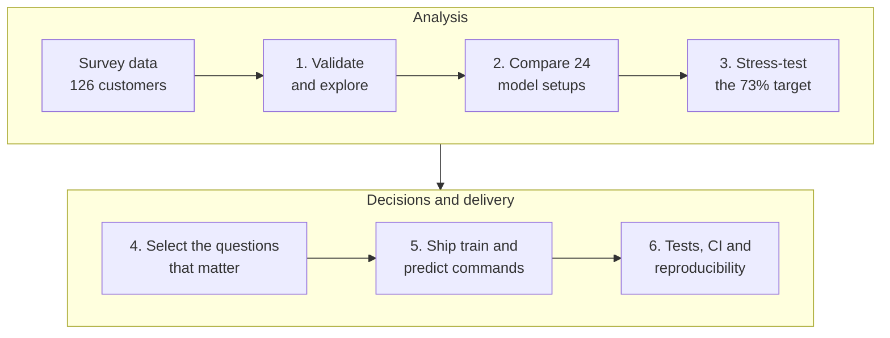
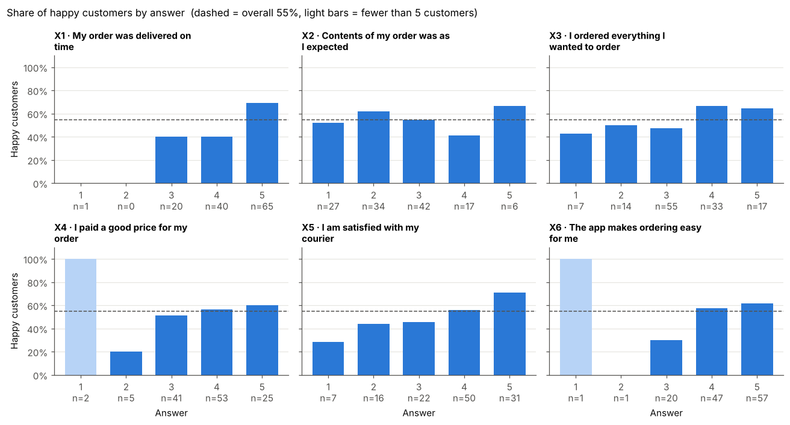

# Predicting Customer Happiness from Delivery Surveys

[](https://github.com/layalsaad/8HX5I2cEoQZKSqlg/actions/workflows/ci.yml)


[](https://github.com/astral-sh/uv)
[](https://github.com/astral-sh/ruff)

An end-to-end machine learning project, completed with [Apziva](https://www.apziva.com/), that
predicts whether a delivery customer is happy from a six-question survey, identifies what drives
their happiness, and ships the result as a tested command-line tool.

The project's defining choice: on a dataset of only 126 customers, it measures accuracy
**honestly** instead of chasing a lucky number, and turns the findings into concrete business
recommendations.

## At a glance

| Topic | Result |
| --- | --- |
| **Expected accuracy on new customers** | **≈ 65%**, against a 54.8% baseline (significant, p = 0.017) |
| **What drives happiness** | On-time delivery. The best model is one rule: *happy if the order was delivered fully on time* |
| **Survey questions that can be removed** | 3 of 6 (X2, X3, X4), and using fewer questions *improves* accuracy (65.1% vs 61.0%) |
| **The 73% target** | Reachable only by luck: the same model scores 38%–85% on single random splits |
| **Engineering** | Python package, `train` / `predict` commands, input validation, 68 tests, CI, fully reproducible |

## Contents

1. [Business problem](#business-problem)
2. [Data](#data)
3. [Project workflow](#project-workflow)
4. [Step-by-step walkthrough](#step-by-step-walkthrough)
5. [Business recommendations](#business-recommendations)
6. [Key decisions and trade-offs](#key-decisions-and-trade-offs)
7. [Repository structure](#repository-structure)
8. [Getting started](#getting-started)
9. [Tech stack](#tech-stack)
10. [Limitations and next steps](#limitations-and-next-steps)
11. [For hiring managers and recruiters](#for-hiring-managers-and-recruiters)

## Business problem

A fast-growing logistics and delivery startup wants to understand what makes its customers happy,
so it can act before they churn. It surveyed a selected group of customers and shared part of the
responses; the rest is kept as a **private test set** to judge the solution on customers it has
never seen.

- **Goal:** predict whether a customer is happy, with at least 73% accuracy, or convince the
  company why the solution is superior.
- **Bonus:** find which questions matter most, the minimal set that preserves the predictive
  power, and whether any question can be removed from the next survey.

## Data

126 survey responses: 69 happy and 57 unhappy customers. Each answers six questions on a scale
from 1 (least) to 5 (most).

| Column | Survey question                                |
| ------ | ---------------------------------------------- |
| `Y`    | Target: 1 = happy, 0 = unhappy                 |
| `X1`   | My order was delivered on time                 |
| `X2`   | Contents of my order was as I expected         |
| `X3`   | I ordered everything I wanted to order         |
| `X4`   | I paid a good price for my order               |
| `X5`   | I am satisfied with my courier                 |
| `X6`   | The app makes ordering easy for me             |

The dataset belongs to the company and is not included in this repository.

## Project workflow



Each step answered one question, and its result decided what the next step looked at.

## Step-by-step walkthrough

### 1. Validate and explore the data

📓 [`notebooks/01_eda.ipynb`](notebooks/01_eda.ipynb)

Every file is checked on load: required columns present, no missing values, whole-number answers
from 1 to 5, and a target of 0 or 1. The same validation later protects the prediction command.



- **Baseline to beat: 54.8%**, the accuracy of always predicting "happy". The 55/45 split is
  balanced enough that accuracy is a fair metric.
- **On-time delivery (X1) behaves like a switch:** 69% of customers who answered 5 are happy,
  versus 39% of everyone else. That suggested a "top-box" feature (was the answer a 5?).
- **Courier satisfaction (X5) rises steadily** from 29% to 71% happy. Price (X4) and contents
  (X2) show no clear relationship.
- **The data has a noise ceiling:** 17 customers gave exactly the same answers as someone with the
  opposite outcome, so no model can classify every customer correctly.

### 2. Compare models with nested cross-validation

📓 [`notebooks/02_modeling.ipynb`](notebooks/02_modeling.ipynb)

Eight models, from a baseline to gradient boosting, were each tried with three ways of encoding
the answers: the raw 1–5 scale, one-hot (one column per answer level) and top-box. That makes 24
configurations.

> [!NOTE]
> **Why nested cross-validation?** With 126 customers, a single 80/20 split tests on just 26
> people, so each customer moves accuracy by almost 4 points. Instead, 5-fold cross-validation is
> repeated 10 times (50 held-out folds), and hyperparameters are tuned *inside* each training
> fold, so the test folds never influence any choice. Model differences are checked with the
> corrected resampled t-test (Nadeau & Bengio), which accounts for overlapping training sets.


| Model (best encoding)           | Nested CV accuracy |
| ------------------------------- | ------------------ |
| Decision tree (top-box)         | **64.7% ± 7.8%**   |
| Gradient boosting (top-box)     | 62.4% ± 7.2%       |
| Random forest (top-box)         | 61.9% ± 8.2%       |
| Naive Bayes (top-box)           | 61.7% ± 8.1%       |
| Logistic regression (top-box)   | 60.7% ± 7.7%       |
| Baseline (always predict happy) | 54.8% ± 1.6%       |

- **Top-box encoding helped 6 of 7 models:** what matters is whether delivery was *fully* on time.
- **Simple beat flexible:** the tuned decision tree collapsed to a single rule, **X1 = 5 → happy**.
  It beats the baseline significantly (p = 0.017) and is statistically tied with the ensembles, so
  the simplest, most explainable model was kept.

### 3. Stress-test the 73% target

The winning rule was scored on 500 different random 80/20 splits to see how much a single
split depends on luck.


The same rule scores anywhere from **38% to 85%**, and **26% of splits reach 73%** by chance.
A report built on one such split would "meet" the target and then disappoint on the private
test set.

> [!IMPORTANT]
> The honest expectation on new customers is about **65%**. The ceiling comes from the survey
> itself (identical answers, opposite outcomes), not from the choice of model.

### 4. Select the questions that matter

📓 [`notebooks/03_feature_selection.ipynb`](notebooks/03_feature_selection.ipynb)

Three complementary methods, trusted only where they agree:

1. **Univariate tests:** is each question, on its own, related to happiness?
2. **Permutation importance:** how much does held-out accuracy drop when one question's answers
   are shuffled? Shuffling X1 costs 3–10 points depending on the model; every other question
   changes accuracy by less than 1 point.
3. **Exhaustive subset search:** all 63 combinations of questions were scored. The
   one-standard-error rule then picked the smallest set within noise of the best. The whole
   search was repeated inside each of the 50 folds, so the selection itself is evaluated honestly.


- **X1 alone is the minimal set.** It scores 65.1%, against 61.0% for all six questions with the
  same model. Every extra question gives the model another way to fit noise.
- **X1 + X5 is the best pair (67.3%)**, but the 2.2-point gain is not significant (p = 0.38).
- **X2, X3 and X4 were never selected** in any of the 50 folds, by either selection model.

### 5. Ship it: `train` and `predict` commands

The chosen model is packaged as two commands, so the company can score its private test set
or any future survey:

```bash
uv run happiness-train
# Trained on 126 customers using X1
# Cross-validated accuracy: 65.1% ± 7.5% (50 folds)

uv run happiness-predict new_answers.csv --output predictions.csv
# Wrote N predictions to predictions.csv
# Accuracy on N labelled rows: …%        (only when the file contains Y)
```

- **Validated input:** a bad file stops with a one-line error and exit code 1, never silent
  wrong predictions.
- **Ready for a shorter survey:** prediction only requires the questions the model uses.
- **Useful output:** every row gets a `prediction` and a `probability_happy` (0.69 for X1 = 5,
  0.38–0.40 otherwise). Extra columns such as customer IDs are kept.
- **Traceable models:** training saves `models/model.joblib` plus `models/model.json`, which
  records the questions used, cross-validated scores, library versions and a fingerprint of the
  training data.

### 6. Engineering quality

- **68 unit tests** on synthetic data cover validation, every model and encoding, the evaluation
  and selection logic, and the train/predict round trip.
- **Continuous integration:** GitHub Actions installs the locked environment and runs linting,
  format checks and tests on every push.
- **Reproducible:** fixed seeds and a lockfile. Re-running every notebook from scratch reproduced
  every number exactly, and every chart byte for byte.

## Business recommendations

The brief's questions are answered in [At a glance](#at-a-glance). Here is what the business
can do with those answers:

1. **Treat "not fully on time" as the main unhappiness signal.** Customers who rate delivery below
   5 are happy only 39% of the time, versus 69% for a 5. They are the customers to follow up with.
2. **Shorten the survey to X1 and X5.** Drop X2, X3 and X4; if X2 is kept, reword it, since "as I
   expected" is ambiguous.
3. **Use the freed space for better questions,** such as how late the order was, whether support
   resolved a problem, or the condition of the items. That is where the remaining accuracy is.

## Key decisions and trade-offs

| Decision          | Chosen                         | Instead of                        | Why                                                    |
| ----------------- | ------------------------------ | --------------------------------- | ------------------------------------------------------ |
| Evaluation        | Nested CV over 50 folds        | One train/test split              | A single split swings from 38% to 85%                  |
| Reported number   | The honest ≈ 65%               | A lucky split showing 73%         | It would not hold on the private test set              |
| Final model       | One-rule decision tree         | Random forest, gradient boosting  | Statistically tied; simplest and explainable           |
| Questions used    | X1 only                        | X1 + X5                           | +2.2 points is within noise; one config line to switch |
| Feature encoding  | Three encodings compared       | Raw 1–5 scale only                | Top-box won for 6 of 7 models                          |
| Scope             | scikit-learn, CLI, tests, CI   | Docker, MLflow, a web API         | Proportionate to 126 rows                              |

## Repository structure

```
.github/workflows/ci.yml   # CI: lint, format check and tests on every push
notebooks/                 # analysis, run in order: 01 EDA → 02 modeling → 03 feature selection
reports/figures/           # charts saved by the notebooks
src/happiness/
├── config.py              # column names, question wording, paths, seeds, selected questions
├── data.py                # loading and validation
├── models.py              # candidate models, answer encodings, hyperparameter grids
├── evaluation.py          # nested cross-validation and the corrected t-test
├── feature_selection.py   # subset search, one-standard-error rule, permutation importance
├── train.py               # happiness-train command
└── predict.py             # happiness-predict command
tests/                     # 68 unit tests on synthetic data
pyproject.toml, uv.lock    # dependencies, pinned for reproducibility
```

## Getting started

Requires [uv](https://docs.astral.sh/uv/), which also installs the right Python version.

```bash
git clone https://github.com/layalsaad/8HX5I2cEoQZKSqlg.git
cd 8HX5I2cEoQZKSqlg
curl -LsSf https://astral.sh/uv/install.sh | sh    # install uv (or: brew install uv)
uv sync                                            # Python 3.12 + locked dependencies
mkdir -p data/raw                                  # place ACME-HappinessSurvey2020.csv here
```

| Task                 | Command                                                     |
| -------------------- | ----------------------------------------------------------- |
| Run the tests        | `uv run pytest`                                             |
| Lint and format      | `uv run ruff check .` · `uv run ruff format .`              |
| Explore the analysis | `uv run jupyter lab` (modeling ~4 min, feature selection ~3 min) |
| Train the model      | `uv run happiness-train`                                    |
| Score new answers    | `uv run happiness-predict answers.csv --output predictions.csv` |

The tests use synthetic data, so they run without the dataset. Only load model files you trained
yourself: joblib files can run code when loaded.

## Tech stack

| Area          | Tools                                                     |
| ------------- | --------------------------------------------------------- |
| Language      | Python 3.12                                               |
| Data and ML   | pandas, NumPy, scikit-learn, SciPy                        |
| Visualization | Matplotlib, Seaborn, Jupyter                              |
| Engineering   | uv (environment and lockfile), Ruff, pytest, GitHub Actions |

## Limitations and next steps

- **Small sample:** 126 customers means roughly ±7–8 points of fold-to-fold uncertainty, and the
  private test result will vary with its size.
- **Selected cohort:** the respondents may not represent all customers.
- **Prediction, not causation:** on-time delivery *predicts* happiness; proving that it *causes*
  happiness would need an experiment.
- **Next:** shorten the survey, add the new questions above, collect more responses, and re-run
  the same nested protocol. If X5's gain becomes significant, switching the model to X1 + X5 is a
  one-line change.

## For hiring managers and recruiters

This project shows how I approach a data science problem: understand the real constraint, measure
honestly, keep the solution as simple as the evidence allows, and deliver something the business
can use.

- **Problem framing:** I identified that the real challenge was not fitting a model but
  *measuring* one reliably on 126 rows, and designed the whole project around that.
- **Statistical rigor:** nested cross-validation, a corrected significance test, the
  one-standard-error rule and permutation importance, so every claim is backed by evidence.
- **Integrity with results:** I showed that the 73% target appears in 26% of random splits by
  luck, and reported the defensible 65% with the reasoning behind it.
- **Business translation:** the analysis became concrete actions: a follow-up rule for at-risk
  customers and a shorter, sharper survey.
- **Production engineering:** a tested Python package, command-line tools with input validation
  and model metadata, CI, and fully reproducible results.
- **Communication:** a step-by-step notebook narrative and charts built for decision-makers.

| Skill                       | Where to see it                                                      |
| --------------------------- | -------------------------------------------------------------------- |
| Exploratory data analysis   | [`01_eda.ipynb`](notebooks/01_eda.ipynb)                             |
| Model selection and evaluation | [`02_modeling.ipynb`](notebooks/02_modeling.ipynb), [`evaluation.py`](src/happiness/evaluation.py) |
| Feature selection           | [`03_feature_selection.ipynb`](notebooks/03_feature_selection.ipynb), [`feature_selection.py`](src/happiness/feature_selection.py) |
| Production ML code          | [`train.py`](src/happiness/train.py), [`predict.py`](src/happiness/predict.py), [`data.py`](src/happiness/data.py) |
| Testing and CI              | [`tests/`](tests), [`ci.yml`](.github/workflows/ci.yml)              |

I'm happy to walk through any part of this project in more detail. Find me on GitHub at
[@layalsaad](https://github.com/layalsaad).
